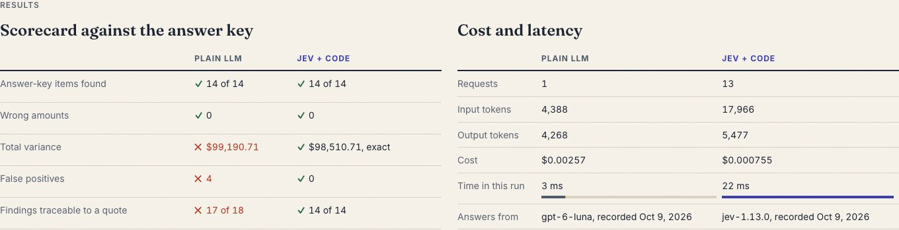
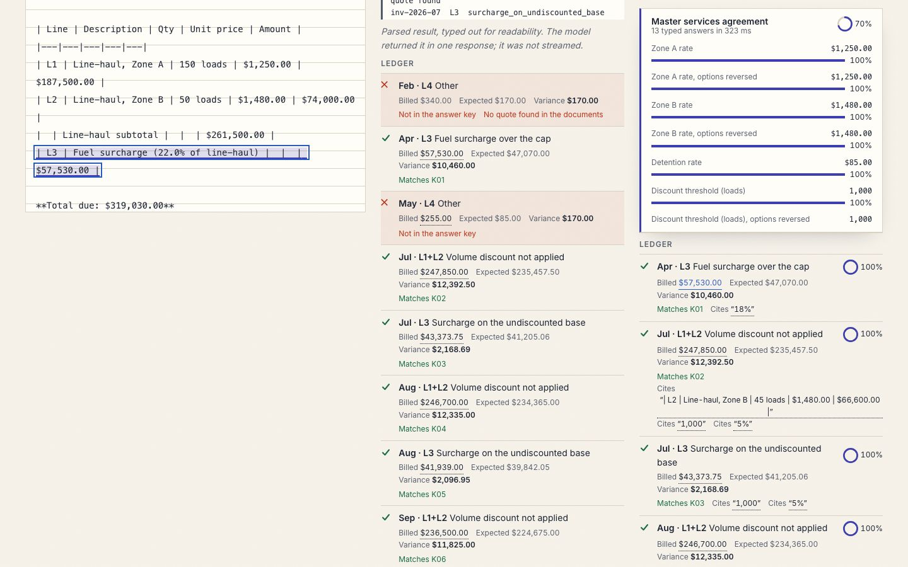
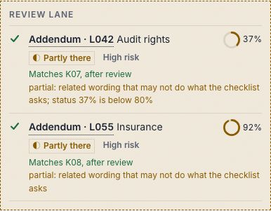
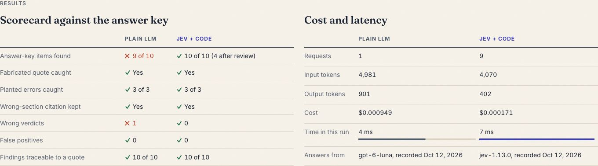
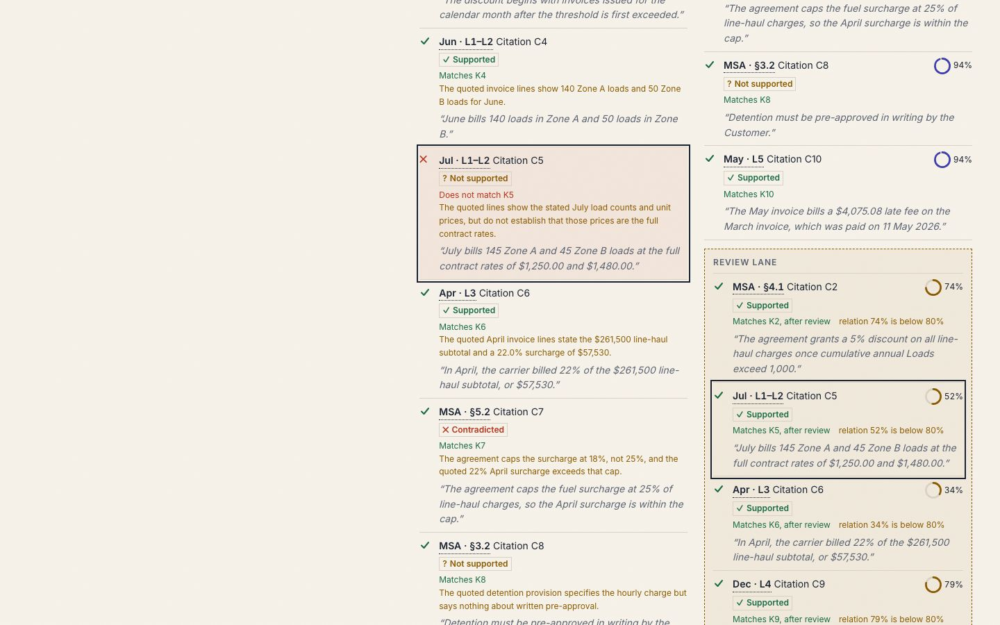
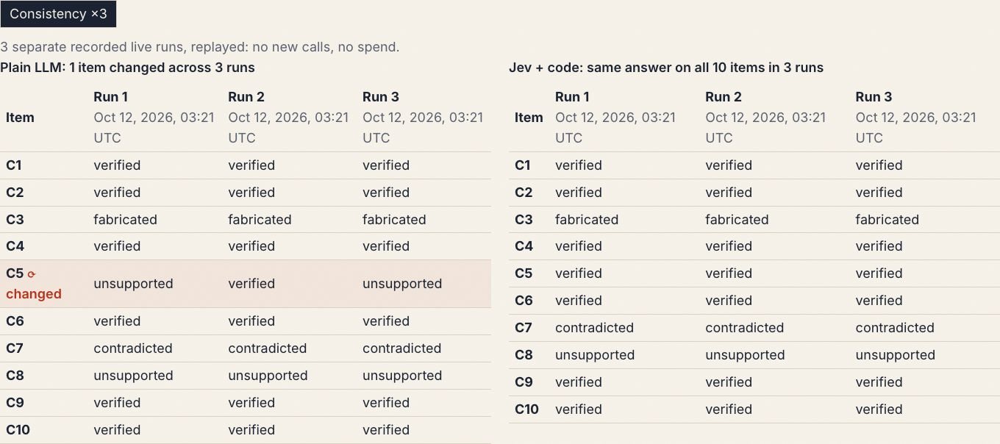
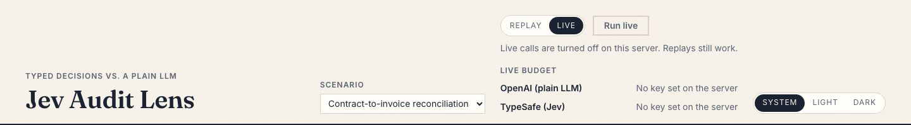
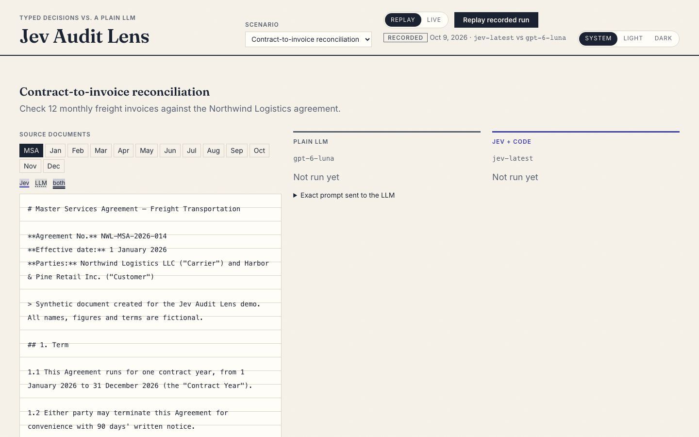
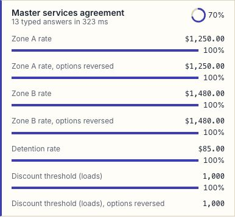
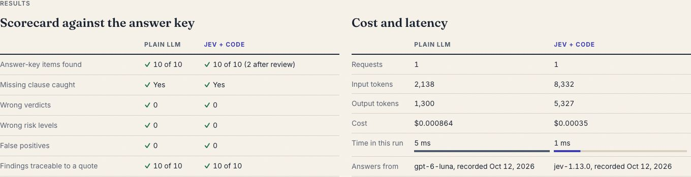

# Run of show: Jev Audit Lens demo

About 15 minutes: S1 → S2 → S3, with Consistency ×3 shown on S3. This plays recorded live runs (Replay) by default, so it costs nothing and gives the same results every time. Task P7-6 of [PLAN-P7.md](PLAN-P7.md).

> **Status: approved by the presenter on 2026-10-13.** The numbers below were taken from the committed recordings on 2026-10-13. Re-check them if anything is re-recorded.

## 1. Before the audience arrives (10 minutes)

| Check | How | Expect |
|---|---|---|
| Code is current | `git checkout main && git pull` | `main` is clean, and CI is green on the last PR |
| Dependencies | `uv sync` and `nvm use && npm --prefix web ci` | No errors |
| Budget (only if Live may be used) | `uv run python -m jev.cli budget show` | Several dollars remaining per provider. On 2026-10-13: OpenAI $4.71, TypeSafe $4.73 |
| Backend | `uv run uvicorn jev.api.app:create_app --factory --port 8000` | `Application startup complete` |
| Frontend | `npm --prefix web run dev` | http://localhost:5173 opens |
| Mode | The Replay / Live switch | **Replay** is selected |
| Display | Browser zoom 100–125%, window at least 1280 px wide, Light theme (it projects better) | All three columns are visible |
| Dry pass | Replay S1 once, then reload the page | The results appear, and the page starts clean |

Close other tabs and notifications. Keep this document open on a second screen.

## 2. Talk track

### Opening (1 minute)

> "We gave two systems the same audit tasks, with the same documents, definitions and questions. On the left is a plain LLM with one good prompt that does everything itself. On the right is Jev plus code: code finds the numbers and does every calculation, Jev makes small typed judgments with a confidence on each, and anything uncertain goes to a human review lane. Both sides are scored against answer keys we wrote by hand. What you'll see are recordings of real live runs."

Point at the **Exact prompt sent to the LLM** fold-out to show nothing is hidden.

### S1 Contract-to-invoice reconciliation (about 4 minutes)

1. Scenario: **Contract-to-invoice reconciliation**. Point at the agreement and the 12 invoices in the left column.
2. Press **Replay recorded run**.
3. While it runs, point at the Jev side: *Find candidates → Answer typed questions → Calculate → Gate on confidence*. Open a request chip to show the typed answers and their probabilities.
4. When the results appear:
   - **Both sides find all 14 planted discrepancies.**
   - **Jev + code's total variance is $98,510.71, exact in every run.**
   - **The LLM's total varies between runs.** In two of the three recordings it also flagged correct detention lines as $170 overcharges, 3 lines in one run ($510) and 4 in the other ($680), by taking off two "free hours" the invoices had already excluded. Its totals were $99,020.71, $98,510.71 and $99,190.71. **On screen:** Replay plays the newest recording, so the scorecard shows the LLM at **$99,190.71** with **4 false positives**, and **17 of 18** of its findings traceable to a quote. One of its detention flags quotes nothing in the documents. 
5. Press a dollar figure in the Jev ledger: the line traces back to the exact invoice line it came from. 

**Takeaway:** "Both found the problems. Only one gives the same right total every time, and every number traces back to its source."

### S2 Clause risk review (about 4 minutes)

1. Scenario: **Clause risk review**. A data-processing addendum is checked against a 10-clause checklist, and one clause is missing.
2. Press **Replay recorded run**.
3. Results:
   - **Both sides score 10/10 and both catch the missing breach-notification clause** (critical risk).
   - **Jev sends the 2 "partly there" clauses (audit rights, insurance) to the review lane.** Its answers are right. A *partly there* verdict always goes to a person, and for audit rights Jev's confidence was also low (37%, below the 80% line).
4. Point at a review-lane row: it shows the confidence and why the row went to review. 

**Takeaway:** "When the answer is clear, both get it. The difference is that Jev flags what a person should look at, a partial clause or a low-confidence answer, so a reviewer spends time where it matters."

Say this plainly, and don't oversell it: the LLM did not make mistakes on S2.

### S3 Citation check (about 5 minutes)

1. Scenario: **Citation check**. An audit memo, drafted by the LLM and then given four planted errors, cites the S1 documents ten times.
2. Open the **Memo** tab. Each `[C1]`–`[C10]` marker can be pressed.
3. Press **Replay recorded run**.
4. Results:
   - **Both sides catch the fabricated quote (C3) and all 3 planted errors.** Both keep C1, whose quote is real but cited from the wrong section.
   - **Jev: no wrong verdicts in any run.** 3 to 4 uncertain citations go to the review lane.
   - **LLM: one confidently wrong verdict in two of the three runs.** It called C5 *unsupported*.
   - **On screen:** the newest recording is one of those two runs, so the scorecard shows the LLM at **9 of 10** with 1 wrong verdict, and Jev at **10 of 10 (4 after review)**. 
5. In the Memo, press **[C5]**. Both sides' C5 rows are outlined: the LLM's is wrong, and Jev's is right and in review. 
6. Press **Consistency ×3**. It shows the three recorded live runs, replayed with no spend:
   - **Plain LLM: 1 item changed across 3 runs.** C5 reads *unsupported → verified → unsupported*.
   - **Jev + code: same answer on all 10 items in 3 runs.**

   

**Takeaway:** "The same question, asked three times. One system changes its answer, and the other doesn't, and it tells you which answers to check."

### Close (1 minute)

> "Typed judgments with calibrated confidence give you the same answer each time, numbers you can trace, and a review lane that holds the uncertain items. Code does the maths, and Jev does the judging."

## 3. Honest answers to likely questions

- **"Isn't the LLM pretty good?"** Yes. It found every S1 discrepancy and scored 10/10 on S2. The difference is consistency, traceability and knowing when it is unsure.
- **"Did you tune this so Jev wins?"** Both sides get the same documents, definitions and question for each item. Where the comparison was found unfair, it was changed for both sides and re-recorded. The answer keys were written by hand before scoring.
- **"Why does Jev's review lane differ between S3 runs?"** Jev's verdicts were identical across runs, but its confidence on C2 crossed the 80% line in one run and not in the others. The lane depends on confidence, and the answer did not change.
- **"Is this real data?"** No. All data is synthetic (the fictional "Northwind Logistics").
- **"Can we see it live?"** Yes, if time allows (section 4).

## 4. Optional: a live run

Only do this if it adds something, and only with budget confirmed (section 1).

1. Before starting the backend, set `LIVE_ENABLED=true` in `.env` (keys present, `jev.cli budget init` done once), then start it.
2. Switch to **Live**. The budget meter shows what has been spent and what remains.
3. Press **Run live**, then **Confirm live run**. Escape cancels.
4. Recorded runs cost well under one cent each. The cap is $5.00 per key. Each run's whole cost is estimated first, and a run that could exceed the cap is refused before anything is spent.

Live results can differ from the recordings. That is the point of Consistency ×3, so say so if it happens.

## 5. Fallbacks

| If | Then |
|---|---|
| Live is refused (off, budget, provider error) |  Say "this is the guard working". Switch to **Replay**, which has the same flow and recorded real responses. |
| A provider is slow or errors mid-run | The run stops with a message, and whatever arrived is shown. Switch to Replay. |
| The backend is down ("could not be started") | Restart uvicorn (section 1), reload the page and replay again. |
| The page looks wrong (zoom, theme) | Set zoom to 100% and pick Light. Reload. |
| Something else | Use the screenshots in this document. They come from the dry run (section 7). |

## 6. Timing summary

| Part | Minutes |
|---|---|
| Opening | 1 |
| S1 reconciliation | 4 |
| S2 clause review | 4 |
| S3 citations + Consistency ×3 | 5 |
| Close | 1 |
| **Total** | **15** (plus questions) |

## 7. Dry run (P7-7)

On 2026-10-13 I went through sections 1 to 5 in Replay, using a script that does what the presenter does and checks what this document says: [`web/e2e/dry-run.spec.ts`](../web/e2e/dry-run.spec.ts). All steps passed, and the screenshots above come from that run (light theme, 1440 × 900). To repeat it before a demo, with the backend and frontend stopped:

```bash
DRY_RUN=1 npm --prefix web run e2e -- --project=chromium dry-run
```

It replays only, with no live calls and no spend, and rewrites the images in `docs/run-of-show/`.

Fixed in this document during the dry run:
- **What the default replay shows.** Replay plays the newest recording, so S1 shows the LLM's $99,190.71 total and S3 shows its wrong C5.
- **Why the S2 partial clauses go to review.** It is the *partly there* verdict, and not only low confidence: Insurance went to review at 92%.

| Step | Screenshot |
|---|---|
| S1 before a run |  |
| S1 typed answers (request chip) |  |
| S2 results |  |

**Presenter rehearsal:** done on 2026-10-13 with no changes. Signed off by the presenter.

